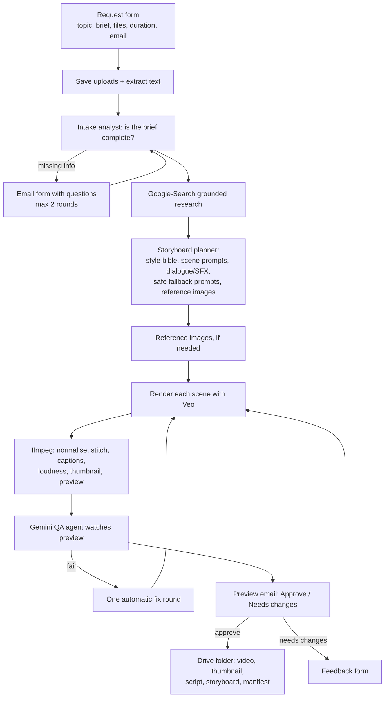

# AI Video Factory (n8n + Veo 3.1)

A request form in, a finished multi-scene video out. The factory researches the topic, writes a storyboard, renders each scene with Google Veo, stitches the clips with ffmpeg (captions, loudness normalisation, thumbnail), has an AI QA agent watch the result, and only saves to Google Drive after a human approves. Every stage has retries and fallbacks, down to an animated still image if video generation fails for a scene.

For a simpler single-clip chat version see [`veo-video-chat`](../veo-video-chat).

## Files

| File | Role | Nodes |
|---|---|---|
| `video-factory-unified.json` | **Recommended.** The whole factory in one workflow (scene renderer inlined as a loop) | 79 |
| `video-factory-main.json` | Same factory, but calls the scene renderer as a sub-workflow | 57 |
| `veo-scene-renderer.json` | The scene-renderer sub-workflow (import first if you use `video-factory-main.json`) | 23 |
| `error-alert.json` | Optional error workflow that emails the admin | 3 |

Choose **one** deployment: `video-factory-unified.json` alone, or `veo-scene-renderer.json` plus `video-factory-main.json`.

## Pipeline



1. **Intake.** A form takes topic, instructions, video type, duration, email and optional documents, images or media. Files are saved and their text extracted. An intake analyst (Gemini) decides whether duration, format and other essentials are known. If not, an email form asks for them (at most 2 rounds).
2. **Research and storyboard.** Search-grounded research feeds a "creative director" planner that writes a style bible and Veo-ready scene prompts (including dialogue and sound effects), softer fallback prompts for safety blocks, and a reference-image plan. A fallback text model covers planner failures.
3. **Render.** Each scene is one Veo clip, rendered one at a time (which also paces the API). A prompt-hash cache means revisions only re-render scenes that changed.
4. **Assemble and QA.** ffmpeg normalises and stitches the clips, burns captions, normalises loudness and makes a thumbnail and preview. A Gemini QA agent watches the preview and can trigger one automatic fix round.
5. **Human approval.** Approve saves everything to Drive. "Needs changes" opens a feedback form and re-renders only what is affected (max 2 rounds). No answer means nothing is saved.

## Scene renderer fallbacks
For each scene: plan the attempt, submit to Veo (`predictLongRunning`), poll, download, save. When something goes wrong the renderer escalates in order:

1. 429 / 5xx responses retry with exponential backoff and jitter.
2. A safety block retries once with a softened prompt.
3. Retry without reference images.
4. Drop to the next model tier: Veo 3.1, then Veo 3.1 Fast, then Veo 3.1 Lite.
5. Last resort: generate a still image with Gemini and turn it into an animated clip with an ffmpeg Ken Burns effect.
6. Report the failure. The job aborts if more scenes fail than `maxFailedScenes` allows.

## Configuration
All global settings are at the top of the `Init Job` node:

| Setting | Default | Meaning |
|---|---|---|
| `qualityProfile` | `quality` | `quality`: Veo 3.1, Fast, Lite, still. `economy`: Fast, Lite, still |
| `resolution` | `720p` | `720p`, `1080p` or `4k` (1080p and 4k force 8-second clips) |
| `maxScenes` / `maxDurationSec` | 12 / 120 | Size limits per job |
| `maxFailedScenes` | 1 | Abort if more scenes than this cannot be rendered |
| `clarifyRoundsMax` / `revisionRoundsMax` / `autoFixRoundsMax` | 2 / 2 / 1 | Question, human-revision and automatic QA loops |
| `qaPassScore` | 7 | QA score out of 10 |
| `enableResearch` | `true` | Gemini with Google Search grounding |
| `burnCaptions` | `true` | Burn captions into the video |
| `scenePaceSec`, `pollIntervalSec`, `maxPollMinutes` | 8, 15, 12 | Rate-limit friendliness and polling |
| `driveParentFolderId` | `root` | Drive folder where job folders are created |
| `adminEmail` | empty | Failure alerts (defaults to the requester) |
| `textModel`, `textModelFallback`, `imageModel` | see node | Gemini models for planning, fallback and stills |

Check the model names in `Init Job` against what your Gemini API plan can access, and check current Veo pricing before you open the form to others.

## Setup

1. **Credentials:** Header Auth named **Gemini API Key** (header `x-goog-api-key`), **Gmail OAuth2**, **Google Drive OAuth2**. Select them on the nodes.
2. **Self-hosted n8n environment:**
   ```
   NODES_EXCLUDE=[]
   NODE_FUNCTION_ALLOW_BUILTIN=fs,zlib
   N8N_DEFAULT_BINARY_DATA_MODE=filesystem
   ```
3. **ffmpeg and fonts** must exist in the container, for example:
   ```dockerfile
   FROM docker.n8n.io/n8nio/n8n
   USER root
   RUN apk add --no-cache ffmpeg ttf-dejavu
   USER node
   ```
   Create `/home/node/.n8n-files/video-jobs` and make it writable.
4. **Import:**
   - Unified: import `video-factory-unified.json`.
   - Split: import `veo-scene-renderer.json` first, copy its workflow ID, import `video-factory-main.json`, and paste that ID into the **Render Scene** node.
5. Edit `Init Job` (models, resolution, limits, Drive folder ID).
6. Optional: import `error-alert.json`, set the admin email, and select it as the Error Workflow of the main workflow.
7. Open the form URL, submit a short test topic, and follow the emails.

## Deliverables (per approved job)
Final video, thumbnail, script, storyboard and a manifest, uploaded to a job folder in Google Drive.

## Tech
n8n, Google Veo 3.1 and Gemini (research, planning, QA, stills), ffmpeg, Gmail, Google Drive.
